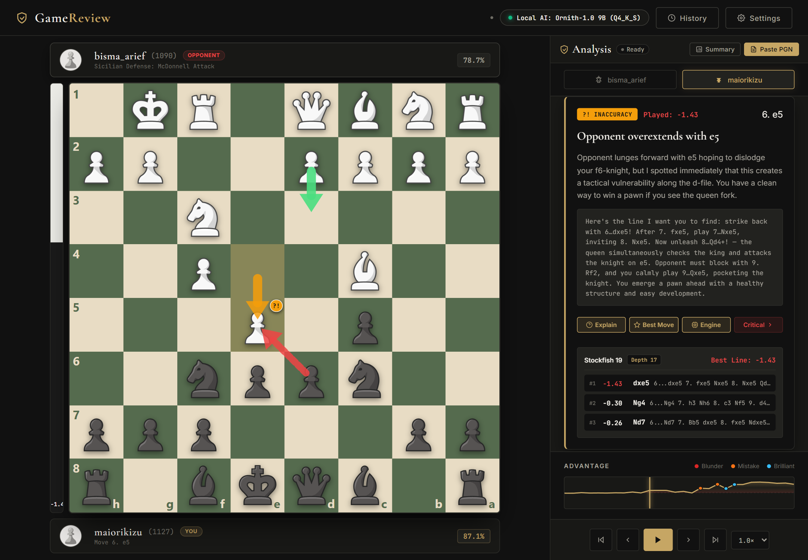
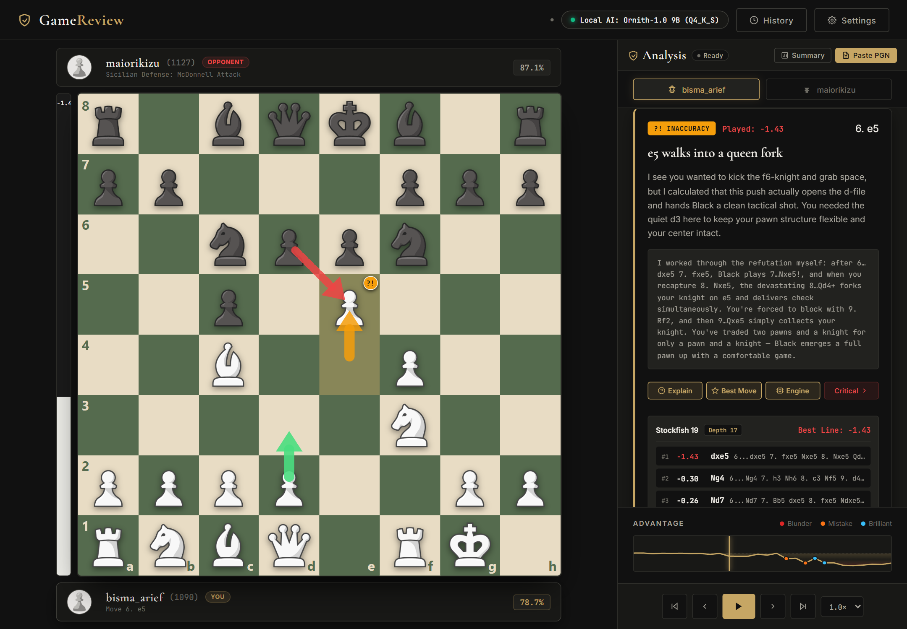
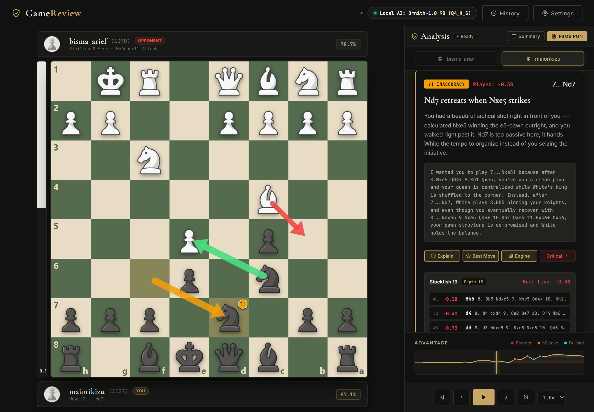
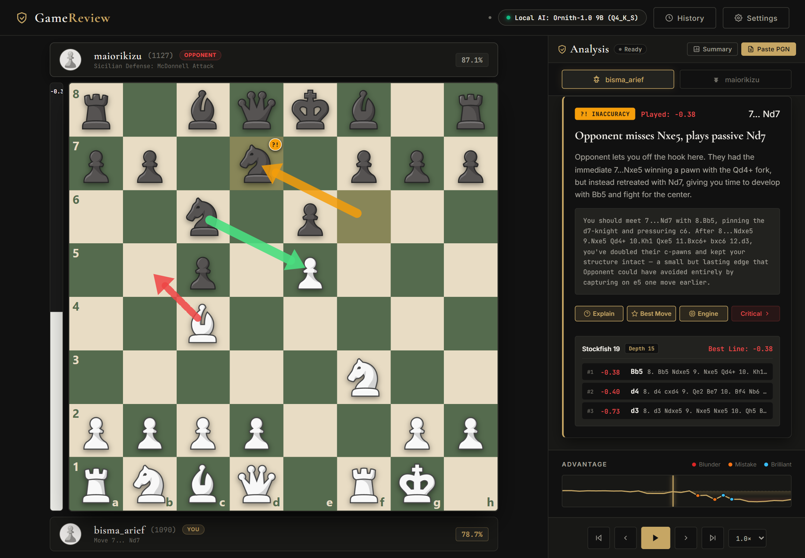
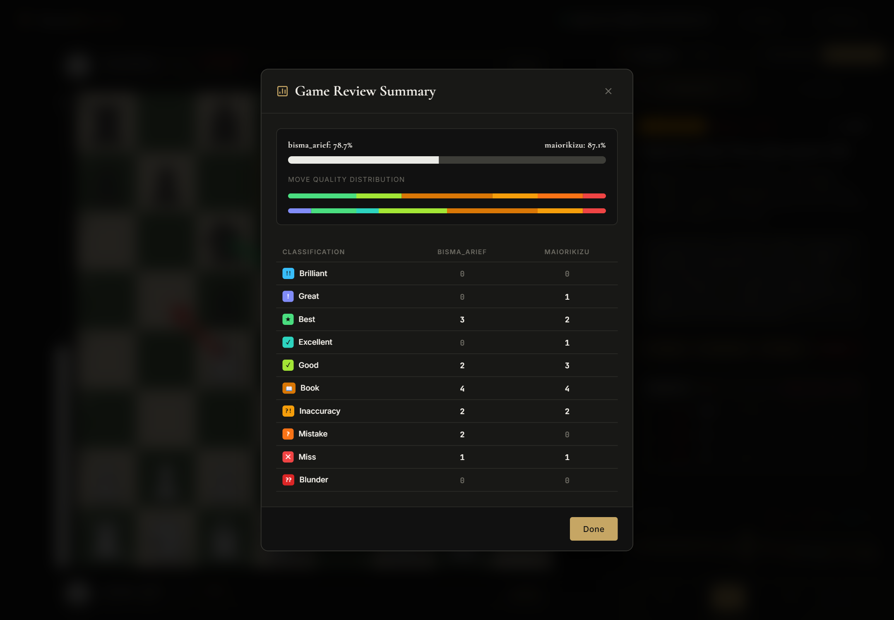

# chess-game-review

An AI chess game review tool.

Stockfish analyses the game, an LLM turns the analysis into coaching feedback.
Python, stdlib `http.server`, SQLite, single-file web UI, PyInstaller build.

## Screenshots

The White/Black buttons at the top pick which side you review as. The coach
panel then reviews every move from that side: your moves get a direct verdict,
opponent moves get advice on how to punish them. Same move, both perspectives:

| Reviewing as Black (maiorikizu) | Reviewing as White (bisma_arief) |
| --- | --- |
|  |  |

Next critical move, same toggle:

| Black perspective | White perspective |
| --- | --- |
|  |  |

Game summary — accuracy, classification counts, and the turning points:



## Flow

1. Load a PGN, or play on the built-in board.
2. Stockfish analyses every move with MultiPV.
3. Eval swings, blunders, missed tactics and opening names are packed into a
   structured prompt.
4. The LLM reply must match a strict JSON schema: validated, auto-repaired
   once, rejected with a clear error if still malformed.
5. The review is saved to SQLite and rendered in the web UI.

## LLM providers

| Tier | Backends |
|---|---|
| Local (default, offline) | llama.cpp (llama-server), Unsloth Desktop, LM Studio, Ollama |
| Cloud (opt-in) | NVIDIA NIM, OpenAI, Anthropic, OpenRouter |

Cloud providers stay disabled until `allow_cloud_api` is enabled; game data
never leaves the machine by default. Rate limits and transient 5xx walk the
provider's model chain (2 attempts per model) before failing, so one down
provider does not end the session.

API keys are encrypted with Windows DPAPI (user scope) before being written to
`ai_config.json`. The web UI only ever sees whether a key is set, not the key.

## Layout

```
app.py                    Entry point: starts the server, opens the UI
server.py                 HTTP server + JSON API routes
engine.py                 Stockfish driver: MultiPV analysis, blunder/inaccuracy classification
ai_provider.py            LLM provider layer: failover chain, DPAPI key store, schema validation/repair
hardware_scanner.py       GPU/VRAM detection, local endpoint probes, model recommendations
openings.py               Opening book build + lookup
history_manager.py        SQLite review history and migrations
app_paths.py              Writable-state vs bundled-resource paths (PyInstaller-safe)
web/index.html            Front end: board, review panel, settings
ChessReviewDesktop.spec   PyInstaller build spec
```

## Run

```bash
git clone https://github.com/maiorikizu/chess-game-review.git
cd chess-game-review
pip install pywebview chess requests psutil
python app.py
```

Stockfish is not bundled. Download it from https://stockfishchess.org/download/
and put `stockfish.exe` beside `app.py`, or make sure `stockfish` is on PATH.

For a local LLM backend, serve a GGUF with llama.cpp:

```bash
llama-server -m model.gguf --port 8888 -ngl 99 -c 4096
```

The app defaults to `http://localhost:8888/v1`, and the settings panel scans
GPU/RAM and recommends a model and quant with direct download links. Unsloth
Desktop, LM Studio, and Ollama also work — pick the endpoint in settings. For
a cloud backend, add your key in settings and enable `allow_cloud_api`.

## Scope

Single-user desktop app: the server binds to localhost, no auth, no HTTPS.

## License

Released under the MIT License. See [LICENSE](LICENSE).
